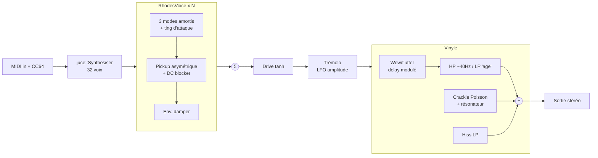

# feat: Instrument Rhodes années 70 avec grain vinyle

## Summary

Construire un plugin instrument JUCE (VST3 + AU, macOS arm64) qui synthétise un Rhodes Mark I par modèle modal + non-linéarité de micro, avec trémolo, drive léger et un étage « vinyle » intégré (crackle, souffle, wow/flutter, bande passante réduite). UI générique de l'hôte. Cible : chargement et jeu dans Ableton Live 12 Lite.

---

## Problem Frame

Le dépôt est vide. L'objectif est un instrument personnel, joué au clavier MIDI dans Live 12 Lite, qui sonne « Rhodes de disque 70s » sans chaîne d'effets externe ni banque d'échantillons. Lite accepte les plugins tiers VST3/AU sur macOS ; il suffit donc d'un plugin correctement typé « instrument » et installé dans les dossiers système.

---

## Requirements

- R1. Le plugin apparaît comme **instrument** dans Live 12 Lite (VST3 et AU) et produit du son sur une piste MIDI.
- R2. Son de type Rhodes : attaque « ting » métallique, sustain long, harmoniques qui augmentent avec la vélocité (« bark »).
- R3. Polyphonie (32 voix, le vol de voix restant un cas rare), pédale de sustain (CC64), relâchement amorti naturel.
- R4. Trémolo (rate, depth) et drive léger réglables.
- R5. Étage vinyle intégré, chaque élément réglable : crackle, hiss, wow/flutter, bande passante (« age »), avec un bypass global.
- R6. Paramètres automatisables et sauvegardés avec le projet Live.
- R7. Pas d'artefact : pas de clic au note-off, pas de NaN/dénormaux, pas d'allocation dans le thread audio, sortie bornée.

---

## Scope Boundaries

- macOS arm64 uniquement ; pas de Windows, pas de VST2.
- Pas d'UI custom (éditeur générique JUCE), pas de presets.
- Pas d'échantillons, pas de distribution / notarisation / installeur.
- Pas de modèle physique « lourd » (différences finies, port-Hamiltonien) : approximation modale bon marché.

### Deferred to Follow-Up Work

- UI custom et presets d'usine.
- Chorus/phaser, réverb à ressort.
- Variante « vinyle » en effet audio séparé (réutilisable sur d'autres pistes).

---

## Key Technical Decisions

- **JUCE via CMake `FetchContent`, tag épinglé** (dernière stable rapportée : 9.0.5, à vérifier au moment de l'implémentation) : framework standard VST3/AU, `COPY_PLUGIN_AFTER_BUILD` installe directement dans `~/Library/Audio/Plug-Ins/{VST3,Components}`. Licence AGPL/EULA sans impact tant que le plugin n'est pas distribué.
- **`IS_SYNTH TRUE`, `NEEDS_MIDI_INPUT TRUE`, codes 4 caractères fixés** (`PLUGIN_MANUFACTURER_CODE Frik`, `PLUGIN_CODE Rhdx`) : sans `PLUGIN_CODE` explicite, JUCE en génère un aléatoire et Live perd l'état sauvegardé.
- **Réutiliser `juce::Synthesiser` / `SynthesiserVoice`** pour l'allocation de voix et la pédale de sustain (déjà gérée), plutôt qu'un gestionnaire maison. Le vol de voix JUCE coupe net (`allowTailOff=false`) : on alloue 32 voix pour qu'il reste rare, et la voix applique un fondu de ~3 ms dans ce cas avant `clearCurrentNote()`.
- **DSP en headers C++ purs (sans JUCE)** dans `src/dsp/` : testables par un petit exécutable `ctest` avec une macro `CHECK` maison (affiche l'échec, code retour ≠ 0) — pas `assert`, neutralisé par `NDEBUG` en Release — sans ajouter Catch2. Le lissage des paramètres se fait par un one-pole maison dans ces headers (pas de `juce::SmoothedValue`).
- **Vélocité → amplitude des modes** (courbe ~vel^1.7), pickup à courbe fixe (gain `g` = paramètre `bark`) : comme sur un vrai Rhodes, le « bark » vient de l'amplitude de la lame devant un micro fixe, donc la dynamique est préservée et le bark s'éteint naturellement avec la note. Normalisation calée sur une vélocité de référence, pas par note.
- **DC blocker (~15 Hz) par voix après le pickup** : le shaper asymétrique crée un offset DC proportionnel à l'amplitude, qui doit disparaître avant le drive, indépendamment du bypass vinyle.
- **Anti-aliasing** : modes ≥ 0,45·fs ignorés au `noteOn` ; `g` réduit dans l'aigu. Oversampling 2× seulement si l'écoute révèle encore du repliement.
- **Modèle de voix** : 3 modes sinusoïdaux amortis (fondamental + modes de cantilever ≈ 6,27× et 17,55×, décroissance rapide des aigus) + transitoire d'attaque bref, passés dans un **waveshaper asymétrique** de micro `tanh(g·(x+b)) − tanh(g·b)` où `g` croît avec la vélocité. Les harmoniques viennent du micro, pas des modes — c'est ce qui donne le « bark ».
- **Paramètres via `AudioProcessorValueTreeState`** + `GenericAudioProcessorEditor` : automatisation et sauvegarde d'état gratuites (R6).
- **Ordre de la chaîne** : voix → somme → drive → trémolo → vinyle → sortie (le vinyle en dernier = « le disque joue tout le mix »).

---

## High-Level Technical Design



---

## Output Structure

```text
CMakeLists.txt
src/
  PluginProcessor.h / .cpp   # APVTS, Synthesiser, chaîne d'effets
  RhodesVoice.h              # adaptateur SynthesiserVoice -> dsp::RhodesTine
  dsp/
    RhodesTine.h             # modes + pickup + enveloppe
    Effects.h                # drive, trémolo
    Vinyl.h                  # crackle, hiss, wow/flutter, band-limit
tests/
  dsp_tests.cpp
README.md
```

---

## Implementation Units

### U1. Squelette CMake + plugin instrument vide

**Goal:** Un plugin instrument muet qui compile, s'installe et apparaît dans Live.
**Requirements:** R1, R6
**Dependencies:** aucune (prérequis machine : `brew install cmake` ; Xcode complet non requis — générateur Unix Makefiles ou Ninja, pas `-G Xcode`)
**Files:** `CMakeLists.txt`, `src/PluginProcessor.h`, `src/PluginProcessor.cpp`, `.gitignore`, `README.md`
**Approach:** `FetchContent` JUCE tag épinglé ; `juce_add_plugin` avec `FORMATS VST3 AU`, `IS_SYNTH`, `NEEDS_MIDI_INPUT`, `COPY_PLUGIN_AFTER_BUILD`, codes fixés ; sortie stéréo seule ; APVTS vide ; éditeur générique. README : build, réglages Live (Settings → Plug-Ins → activer AU / VST3 system folders → Rescan), dépannage (`codesign --force --deep -s -`, `killall -9 AudioComponentRegistrar`). Commandes de build documentées : configure `cmake -B build` (`CMAKE_OSX_ARCHITECTURES=arm64`), build, puis `ctest --test-dir build`.
**Test expectation:** none — scaffolding ; validé par U6.
**Verification:** le build produit `.vst3` et `.component` dans `~/Library/Audio/Plug-Ins/` ; `auval -v aumu Rhdx Frik` passe ; le plugin est listé dans Live sous Plug-ins > instruments.

### U2. DSP de voix Rhodes

**Goal:** Une voix qui sonne Rhodes, sans dépendance JUCE.
**Requirements:** R2, R7
**Dependencies:** U1 (cible de test CMake)
**Files:** `src/dsp/RhodesTine.h`, `tests/dsp_tests.cpp`, `CMakeLists.txt` (cible `dsp_tests` + `add_test`)
**Approach:** état par voix : phases et amplitudes (∝ vélocité) de 3 modes avec décroissances exponentielles distinctes (aigus en dizaines de ms, fondamental en secondes, plus court dans les graves/aigus extrêmes) ; transitoire « ting » court ; pickup asymétrique (bias `b` fixe = voicing, gain `g` = paramètre `bark`, réduit dans l'aigu) suivi d'un DC blocker ; normalisation calée sur une vélocité de référence ; modes au-delà de 0,45·fs ignorés ; enveloppe de release (damper) ~80–150 ms. Calcul des coefficients au `noteOn`, rien n'est alloué en `render`.
**Execution note:** écrire les tests de propriétés avant de régler le timbre à l'oreille.
**Test scenarios:**
- noteOn(A4=440 Hz, vel 0.8) : la fréquence dominante (pic Goertzel/autocorrélation sur 0,5 s après 50 ms, pas les passages par zéro bruts) ≈ 440 Hz ±1 %.
- vel 1.0 vs vel 0.2 : le rapport énergie harmoniques (2f,3f) / fondamental est nettement plus élevé à 1.0 (bark), et le RMS est ≥ 12 dB plus fort.
- Note tenue vel 1.0 : moyenne de la sortie ≈ 0 (DC bloqué).
- Note 108, vel 1.0, 44,1 kHz : pas d'énergie spectrale significative hors harmoniques (pas de repliement).
- Note tenue 3 s : l'amplitude décroît de façon monotone (enveloppe RMS par fenêtres de 100 ms) sans tomber à zéro avant 1 s.
- noteOff : l'amplitude passe sous -60 dB en < 300 ms et le premier échantillon après noteOff ne saute pas (pas de clic : |Δ| < seuil).
- Bords : note MIDI 21 et 108 à vel 1.0 → sortie finie, |y| ≤ 1.
- Sample rate 44,1 / 48 / 96 kHz : même hauteur mesurée.
**Verification:** `ctest` vert.

### U3. Polyphonie, MIDI, sustain, paramètres

**Goal:** Jouer le Rhodes dans l'hôte.
**Requirements:** R1, R3, R6
**Dependencies:** U2
**Files:** `src/RhodesVoice.h`, `src/PluginProcessor.h`, `src/PluginProcessor.cpp`
**Approach:** `RhodesVoice : juce::SynthesiserVoice` enveloppe `dsp::RhodesTine` ; 32 voix ; `Synthesiser` gère CC64 ; sur vol de voix (`allowTailOff=false`) la voix fait un fondu ~3 ms. Paramètres APVTS : `bark` (gain pickup max), `decay`, `volume`. Lecture des paramètres une fois par bloc. `getStateInformation`/`setStateInformation` via APVTS.
**Test scenarios:**
- Test d'intégration manuel dans Live : accord de 10 notes + pédale → toutes tenues jusqu'au relâchement de la pédale.
- Test scripté : 33 notes tenues pour forcer un vol → saut max d'échantillon sous un seuil (pas de clic).
- Test manuel : 33 notes avec pédale dans Live → pas de plantage, pas de clic audible.
- Sauvegarder un set Live avec des réglages modifiés, rouvrir → réglages restaurés.
**Verification:** jouable au clavier dans Live ; pluginval (U6) passe le test d'état.

### U4. Drive et trémolo

**Goal:** Couleur 70s : saturation douce et trémolo d'ampli.
**Requirements:** R4, R7
**Dependencies:** U3
**Files:** `src/dsp/Effects.h`, `src/PluginProcessor.cpp`, `tests/dsp_tests.cpp`
**Approach:** drive = `tanh` avec pré-gain et compensation de niveau ; trémolo = LFO sinus en amplitude, décalage de phase L/R fixe de 90° (auto-pan doux type Suitcase, pas de paramètre). Paramètres lissés par one-pole maison pour éviter le zipper. Params : `drive`, `tremRate` (0,5–10 Hz), `tremDepth`.
**Test scenarios:**
- Depth 0 → sortie identique à l'entrée (à l'epsilon près).
- Depth 1, rate 4 Hz sur un signal constant → enveloppe qui oscille à 4 Hz ±5 %.
- Depth 1 : enveloppes L et R déphasées de ~90°.
- Drive max sur entrée pleine échelle → |y| ≤ 1, aucun NaN.
**Verification:** `ctest` vert ; audible dans Live.

### U5. Étage vinyle

**Goal:** Grain de disque réglable élément par élément.
**Requirements:** R5, R7
**Dependencies:** U3
**Files:** `src/dsp/Vinyl.h`, `src/PluginProcessor.cpp`, `tests/dsp_tests.cpp`
**Approach:** wow/flutter = ligne à retard fractionnaire centrée ~1,5 ms (interpolation cubique, buffer préalloué au `prepare`) ; profondeurs exprimées en déviation de hauteur : wow ~0,5 Hz jusqu'à ~0,3 % à `wow`=1, flutter ~8 Hz jusqu'à ~0,05 %, plus dérive aléatoire lente. La latence fixe est déclarée à l'hôte (`setLatencySamples`) et conservée même en bypass pour ne pas décaler le timing ; band-limit = HP ~40 Hz + LP piloté par `age` (16 kHz → ~6 kHz) ; crackle = impulsions de Poisson (taux 1–30/s) d'amplitude aléatoire, rares « pops » plus forts, filtrés par un résonateur 1–5 kHz ; hiss = bruit blanc filtré passe-bas autour de -55 dBFS × réglage. RNG déterministe seedable (testabilité). Params : `crackle`, `hiss`, `wow`, `age`, `vinylOn`. Le crackle/hiss tourne même sans note jouée (le disque tourne), coupé par `vinylOn`. Le plugin déclare une queue infinie (`getTailLengthSeconds`) pour que Live continue d'appeler le traitement quand la piste est inactive.
**Test scenarios:**
- Tous les réglages à 0 et `age` à 0 → réponse quasi transparente sur un sinus 1 kHz (écart < -40 dB hors retard).
- Crackle à 1 sur 10 s de silence, seed fixe → nombre d'impulsions dans la plage attendue du taux réglé.
- Hiss à 1 sur silence → niveau RMS dans ±6 dB de la cible.
- Wow à 1 sur sinus 1 kHz → hauteur instantanée qui varie, écart max ≈ 0,3 % (< 0,5 %) ; flutter seul < 0,1 %.
- `vinylOn` off → sortie = entrée retardée de la latence déclarée, aucune énergie de crackle/hiss sur silence.
- Toutes les commandes au max sur signal pleine échelle → sortie finie et bornée.
**Verification:** `ctest` vert ; sur une note tenue dans Live, le pleurage et le crackle sont audibles mais pas envahissants aux réglages par défaut.

### U6. Validation hôte

**Goal:** Prouver que le plugin est sûr à charger dans Live.
**Requirements:** R1, R6, R7
**Dependencies:** U3–U5
**Files:** `README.md` (section validation)
**Approach:** pluginval n'est pas dans Homebrew : télécharger la release macOS sur GitHub (retirer la quarantaine avec `xattr -dr com.apple.quarantine` si besoin). Lancer `pluginval --strictness-level 10 --skip-gui-tests` sur le `.vst3` et le `.component`, `auval -v aumu Rhdx Frik`, puis test manuel Live (charger, jouer, automatiser un paramètre, sauver/rouvrir le set).
**Test expectation:** none — étape de validation, pas de nouveau code.
**Verification:** pluginval et auval passent ; checklist manuelle Live cochée.

---

## Risks & Dependencies

| Risque | Mitigation |
|---|---|
| Version JUCE rapportée (9.0.5) non vérifiée | Épingler le tag réellement disponible au moment de U1 |
| Bundle mal signé après copie → Live ignore le plugin sur arm64 | Ré-signature ad-hoc documentée dans le README ; vérifier `codesign -v` après build |
| Cache AU obsolète après changement de code | `killall -9 AudioComponentRegistrar` + Rescan (Option-clic) dans Live |
| Timbre « pas assez Rhodes » malgré tests verts | Les tests vérifient des propriétés, pas le goût : prévoir une itération d'écoute sur bias/gain du pickup et décroissances |
| CPU : 32 voix × shaper + vinyle | Modèle volontairement léger ; voix inactives non rendues (comportement `Synthesiser`) |

---

## Sources & Research

- JUCE releases et CMake API : https://github.com/juce-framework/JUCE/releases, `docs/CMake API.md` du dépôt JUCE
- Plugins dans Live 12 : https://www.ableton.com/en/live-manual/12/using-plug-ins/, https://help.ableton.com/hc/en-us/articles/115000349184
- Modèle Rhodes : Falaize & Hélie, JSV 2017 (https://hal.archives-ouvertes.fr/hal-01470949) ; Shear, UCSB 2011 (https://www.mat.ucsb.edu/Masters/GregShearMasters2011_12_5.pdf)
- pluginval : https://github.com/Tracktion/pluginval
