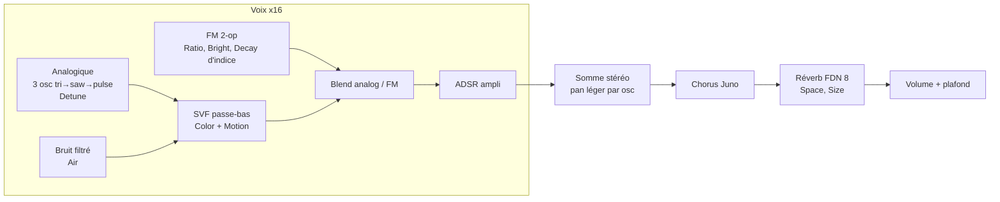

# feat: Frikfrak Kankyo — pads ambient japonais

## Summary

Troisième plugin : un instrument polyphonique de pads « deep » inspiré du kankyō ongaku (Yoshimura, Ashikawa, Takada, Hosono, Shimizu, Sakamoto). Deux couches mélangeables — analogique (oscillateurs désaccordés filtrés) et FM 2 opérateurs (verre, cloches, marimba) — plus un souffle de bruit filtré, un chorus façon Juno et une grande réverbération intégrée. 16 réglages macro sur deux rangées, 36 presets répartis en 6 familles.

---

## Problem Frame

Le Rhodes couvre la nu soul ; il manque un instrument d'atmosphère : nappes lentes, cloches de verre FM façon DX7, gouttes d'eau, drones, souffle de shō. Il doit sonner « deep » seul sur une piste MIDI de Live, sans chaîne d'effets externe (plug and play, comme les autres Frikfrak).

---

## Requirements

- R1. Instrument VST3/AU « Frikfrak Kankyo », polyphonique (16 voix), stéréo, chargeable sur une piste MIDI de Live 12 Lite.
- R2. Couche analogique : forme d'onde continue triangle → dent de scie → impulsion, désaccord multi-oscillateurs, passe-bas résonant doux, sans aliasing audible.
- R3. Couche FM 2 opérateurs : rapports modulateur/porteuse choisis parmi un jeu fixe (cloche, verre, marimba), indice de brillance, et décroissance de l'indice pour les sons frappés.
- R4. Souffle : bruit filtré (shō, vent, respiration) mélangeable.
- R5. Enveloppe ADSR lente (attaque jusqu'à ~8 s, release jusqu'à ~12 s) partagée par les couches ; « Motion » = LFO lent sur la coupure et la largeur d'impulsion.
- R6. Chorus stéréo façon Juno et réverbération hall intégrée (decay jusqu'à ~10 s, aigus amortis), stables à tous les réglages.
- R7. 36 presets en 6 familles, menu dans l'interface + programmes hôte, preset sauvé avec le set (même mécanique que le Rhodes).
- R8. Interface partagée : 16 potards sur deux rangées de 8.
- R9. Temps réel : pas d'allocation dans `processBlock`, sortie finie et bornée, aucun clic au note-off.

---

## Key Technical Decisions

- **Deux couches + souffle, pas un synthé complet.** La variété demandée (pads, verre, eau, drones, shō) se couvre avec analogique + FM + bruit ; un synthé complet demanderait une autre interface. *Green* de Yoshimura est documenté comme un disque fait sur synthés FM Yamaha (DX7/TX7/FB01), d'où la couche FM ; les pads analogiques sont un choix de design.
- **16 macros** (au lieu d'une dizaine annoncée) : en dessous, impossible d'avoir à la fois cloches frappées (Decay/Sustain) et pads tenus, ni réverb réglable en taille. Deux rangées de 8 dans l'éditeur.
- **Rapports FM discrets** : 1, 2, 3, 3.5, 5.19, 7, 14 (1:3.5 = cloche tubulaire DX7, 2:7 → marimba, ~14 = tine). Paramètre « Ratio » 0..1 qui sélectionne un rapport (pas d'interpolation, sinon on passe par des sons désaccordés en tournant le bouton).
- **Oscillateurs polyBLEP** (dent de scie / impulsion) et triangle par intégration ; morph Shape continu. Standard, léger, pas de tables.
- **Filtre SVF TPT 2 pôles** (Zavalishin) : stable sous modulation rapide, résonance douce fixe faible.
- **Réverbération FDN 8 lignes** avec matrice de Householder, délais premiers étagés, amortissement 1 pôle par ligne, légère modulation des délais (anti-métallique), pré-delay ~30 ms. Paramètres : Space (mix) et Size (decay 1.5 → 10 s). Placée dans le DSP partagé (réutilisable).
- **Chorus Juno** : deux lignes modulées en opposition (L/R), taux ~0.5 Hz (Chorus I) → ~0.8 Hz (II) selon le réglage, mix croissant. Partagé aussi.
- **Mécanique des presets mise en commun** : la table `ParamSpec`/`Preset` et le glue JUCE (layout depuis les specs, programmes, sauvegarde de l'index) passent dans `shared/` ; le Rhodes migre dessus sans changement de comportement. Deux plugins à presets = le bon moment pour factoriser.
- **Nom et codes** : produit « Frikfrak Kankyo », `PLUGIN_CODE Knkx`, dossier `plugins/kankyo/`.

---

## High-Level Technical Design

Chaîne du signal (par voix puis bus stéréo) :



Paramètres (ordre = potards, 2 rangées) :

| Rangée 1 — source | Rangée 2 — temps et espace |
|---|---|
| Blend, Shape, Detune, Color, Ratio, Bright, Air, Motion | Attack, Decay, Sustain, Release, Chorus, Space, Size, Volume |

---

## Output Structure

```text
shared/presets/PresetTable.h        # ParamSpec + Preset génériques, C++ pur
shared/plugin/PresetHost.h          # glue JUCE : layout, programmes, état
shared/dsp/Space.h                  # Chorus + Reverb FDN
plugins/kankyo/CMakeLists.txt
plugins/kankyo/src/PluginProcessor.{h,cpp}
plugins/kankyo/src/PadVoice.h       # juce::SynthesiserVoice qui enveloppe dsp::Pad
plugins/kankyo/src/Presets.h        # specs + 36 presets
plugins/kankyo/src/dsp/Pad.h        # voix pure C++ (osc, SVF, FM, bruit, ADSR)
```

---

## Implementation Units

### U1. Mécanique de presets partagée

**Goal:** Sortir `ParamSpec`/`Preset` et le glue JUCE des presets du Rhodes vers `shared/`, sans changer le comportement du Rhodes.
**Requirements:** R7
**Dependencies:** aucune
**Files:** `shared/presets/PresetTable.h`, `shared/plugin/PresetHost.h`, `plugins/rhodes/src/Presets.h`, `plugins/rhodes/src/PluginProcessor.{h,cpp}`, `tests/dsp_tests.cpp`, `CMakeLists.txt`
**Approach:** Table générique (specs + presets en tableaux de taille N). Helper JUCE : construire le `ParameterLayout`, appliquer un preset, nom de programme, sauver/relire l'index courant dans l'état. Le Rhodes l'utilise ; IDs et valeurs inchangés.
**Patterns to follow:** `plugins/rhodes/src/Presets.h`, `RhodesProcessor::setCurrentProgram`.
**Test scenarios:** une fonction de validation générique (noms uniques non vides, valeurs dans les bornes, Init = défauts) appliquée au Rhodes puis à Kankyo ; les tests Rhodes existants passent inchangés.
**Verification:** `dsp_tests` vert ; `auval` Rhodes OK ; un set existant garde son preset et ses valeurs.

### U2. Éditeur sur plusieurs rangées

**Goal:** `ui::Editor` passe à la ligne au-delà de 8 potards.
**Requirements:** R8
**Dependencies:** aucune
**Files:** `shared/ui/FrikfrakEditor.h`
**Approach:** Grille de 8 colonnes max, hauteur de carte = rangées × cellule. Rhodes (8) et Vinyl Noise (3) inchangés visuellement.
**Test scenarios:** Test expectation: none -- UI ; vérification par rendu PNG (harnais hors dépôt) des trois plugins.
**Verification:** Kankyo s'affiche en 2 × 8 ; Rhodes et Vinyl identiques aux rendus précédents.

### U3. Chorus et réverbération partagés

**Goal:** `dsp::Chorus` et `dsp::Reverb` purs, testés.
**Requirements:** R6, R9
**Dependencies:** aucune
**Files:** `shared/dsp/Space.h`, `tests/dsp_tests.cpp`
**Approach:** Voir KTD. Buffers alloués dans `prepare`. Mix 0 = sortie identique à l'entrée (bypass exact). Decay mappé en RT60 cible → gain de feedback par ligne selon sa longueur.
**Patterns to follow:** `dsp::Phaser`, `dsp::Smoother` dans `shared/dsp/Effects.h`.
**Test scenarios:**
- Chorus mix 0 et Reverb mix 0 : sortie identique à l'entrée.
- Réverb : impulsion → RT60 mesuré (pente de l'énergie) croît avec Size ; Size 0 ≈ 1.5 s et Size 1 ≈ 10 s à ±40 %.
- Réverb Size 1 sur bruit plein niveau 30 s : sortie finie, bornée, énergie qui retombe après coupure de l'entrée (pas d'auto-oscillation).
- Réverb : corrélation L/R d'une impulsion < 0.5 (largeur stéréo).
- Chorus : sinus 1 kHz → hauteur modulée (déviation mesurable > 0 et < 1 %).

### U4. Voix Pad en C++ pur

**Goal:** `dsp::Pad` : 3 oscillateurs analogiques morphables + bruit + SVF + FM 2-op + ADSR, mono par voix avec sortie stéréo légère.
**Requirements:** R2, R3, R4, R5, R9
**Dependencies:** aucune
**Files:** `plugins/kankyo/src/dsp/Pad.h`, `tests/dsp_tests.cpp`
**Approach:** Paramètres lus par bloc depuis une struct (comme `Vinyl::Params`). Detune étale 3 oscillateurs ±(0 → 25 cents) et les répartit en stéréo. Motion = LFO 0.1–0.3 Hz par voix (phase aléatoire déterministe) sur coupure et largeur d'impulsion. FM : porteuse à la note, modulateur au rapport choisi, indice = Bright × enveloppe d'indice (décroissance pilotée par Decay). ADSR exponentielle, release depuis le niveau courant (pas de saut).
**Execution note:** Implement test-first pour la hauteur FM et l'enveloppe (faciles à rater silencieusement).
**Patterns to follow:** `plugins/rhodes/src/dsp/RhodesTine.h` (voix pure + `noteOn/noteOff/process/isActive`), helpers `goertzel`/`peakFreq` des tests.
**Test scenarios:**
- Blend 0, Shape saw, Detune 0 : fondamentale mesurée = fréquence de la note à ±0.5 %.
- Blend 1, Ratio 1 : fondamentale = note ; Ratio 3.5 : composante à 3.5 × f présente quand Bright > 0, absente quand Bright = 0.
- Attack 2 s : niveau à 0.1 s < 20 % du niveau à 2 s ; Release 4 s : niveau 1 s après note-off entre 30 % et 90 % du niveau tenu ; la voix devient inactive après la fin du release.
- Sustain 0 + Decay court (son frappé) : niveau à 2 s < 5 % du pic.
- Note-off pendant l'attaque : pas de saut d'échantillon > 0.05.
- Notes extrêmes (21, 108) à tous les extrêmes de paramètres : sortie finie et bornée ; dent de scie à 4 kHz : énergie repliée sous la fondamentale < -40 dB (polyBLEP efficace).
- Air 1, Blend 0, niveau d'oscillateurs nul : sortie = bruit filtré non nul.

### U5. Plugin Kankyo (glue JUCE)

**Goal:** Instrument chargeable, 16 voix, chaîne voix → chorus → réverb → volume.
**Requirements:** R1, R7, R9
**Dependencies:** U1, U3, U4
**Files:** `plugins/kankyo/CMakeLists.txt`, `plugins/kankyo/src/PluginProcessor.{h,cpp}`, `plugins/kankyo/src/PadVoice.h`, `CMakeLists.txt`
**Approach:** Calqué sur le Rhodes (`juce::Synthesiser`, voix qui enveloppe la voix pure). `IS_SYNTH TRUE`, `PLUGIN_CODE Knkx`, VST3 `Instrument Synth`. Queue déclarée = release max + decay réverb. Éditeur partagé avec accroche « Kankyō ongaku ».
**Patterns to follow:** `plugins/rhodes/`.
**Test scenarios:** Test expectation: none -- glue JUCE ; DSP couvert par U3/U4, intégration par `auval` + rendu.
**Verification:** `auval -v aumu Knkx Frik` réussit ; le plugin apparaît dans Live et joue.

### U6. 36 presets

**Goal:** Table de 36 presets en 6 familles.
**Requirements:** R7
**Dependencies:** U1, U5
**Files:** `plugins/kankyo/src/Presets.h`, `tests/dsp_tests.cpp`
**Approach:** Familles et noms ci-dessous ; valeurs réglées à partir des points de départ de la recherche (pads : attack 1.5–4 s, release 4–8 s, coupure 800–2000 Hz ; verre : rapport 1:3.5 ou 5.19, release 3–6 s ; marimba : 2:7 ou 1:1, decay d'indice 80–150 ms ; réverb 4–10 s). Puis rendu audio rapide de chaque preset (harnais hors dépôt) pour vérifier niveau et absence de clipping.
**Test scenarios:** validation générique de U1 (36 presets, noms uniques, bornes, Init = défauts) ; rendu d'un accord de 2 s par preset → crête ≤ 1 et RMS entre -30 et -8 dBFS (niveaux homogènes).
**Verification:** tests verts ; écoute dans Live.

| Famille | Presets |
|---|---|
| Init | Init |
| Pads chauds | Asagiri, Kumo, Hidamari, Yuki, Tegami, Ensoku |
| Verre et cloches | Garasu, Kori, Suisho, Fuurin, Tsurara, Yoake |
| Souffle et shō | Sho, Kaze, Iki, Asa no Ki, Yuuge, Kasumi |
| Drones sombres | Yoru, Fukai, Tsuki, Mori, Oku, Zen |
| Maillets et eau | Mizu, Ame, Shizuku, Marimba Kage, Vibe Asa, Take |
| Évolutifs et hybrides | Nagare, Tsuyu, Shio, Niwa, Umi |

(36 avec Init.)

### U7. Documentation

**Goal:** README (plugin, paramètres, familles de presets, `auval`), `CLAUDE.md` (shared/presets, shared/plugin, Space.h).
**Requirements:** R1
**Dependencies:** U6
**Files:** `README.md`, `CLAUDE.md`
**Test scenarios:** Test expectation: none -- documentation.

---

## Scope Boundaries

- Pas d'échantillons ni de field recordings ; pas d'arpégiateur/séquenceur.
- Pas d'opérateurs FM à fréquence fixe ni de notes aléatoires (« Fuurin », « Hotaru » restent des timbres, pas des générateurs d'événements).

### Deferred to Follow-Up Work

- Écho (delay façon Space Echo) : utile au genre, mais un 17ᵉ potard ; à ajouter si la réverb seule ne suffit pas.
- Vélocité → brillance FM.

---

## Risks

- **Qualité de la réverb** : c'est le cœur du « deep » et la partie la plus délicate (son métallique, coloration). Mitigation : délais premiers, modulation lente, amortissement ; écoute avant de figer les presets.
- **CPU** : 16 voix × 3 osc + FM + SVF + FDN 8 lignes : modeste pour Apple Silicon ; voix inactives non rendues.
- **Presets non documentés** : la recherche n'a trouvé que peu de réglages réels ; les presets sont des interprétations d'ambiance à valider à l'oreille.
- **Refacto U1** : toucher la mécanique du Rhodes peut casser ses sets ; les IDs et l'index de programme sauvegardé restent identiques, vérifié par tests + rechargement d'un set.

---

## Sources & Research

- *Green* (1986) de Hiroshi Yoshimura enregistré sur Yamaha DX7, TX7, FB01 — [fondsound.com](https://www.fondsound.com/hiroshi-yoshimura-green-1986) (source fan), corroboré par [Smack Media](https://smackmedia.ca/deep-cuts/green).
- *Music for Nine Post Cards* (1982) : Fender Rhodes, enregistré à domicile — [Wikipedia](https://en.wikipedia.org/wiki/Music_for_Nine_Post_Cards).
- Midori Takada, *Through the Looking Glass* : marimbas, gongs, carillons — [Wikipedia](https://en.wikipedia.org/wiki/Midori_Takada) ; Satoshi Ashikawa, *Still Way* : piano, harpe, vibraphone — [Wikipedia](https://en.wikipedia.org/wiki/Satoshi_Ashikawa).
- Cloche tubulaire DX7 ≈ 1:3.5 — [Understanding the DX7](https://www.muzines.co.uk/articles/understanding-the-dx7/7900) ; marimba 2:7 (patch Silicon Mallets) ; tine FM ≈ 14–18 — [Attack Magazine](https://www.attackmagazine.com/technique/tutorials/fm-electric-piano/).
- Chorus Juno ≈ 0.5 Hz / 0.83 Hz (émulation TC Electronic June-60, pas le manuel d'origine).
- Non trouvés : matériel de Hosono (*Watering a Flower*), Shimizu (*Kakashi*), Sakamoto (*1996*, *async*), réverbs utilisées. Valeurs de réverb/enveloppes = points de départ, non sourcés.
