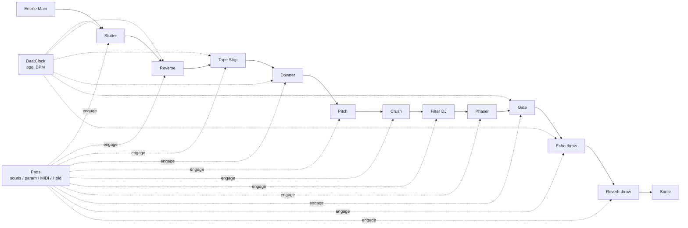
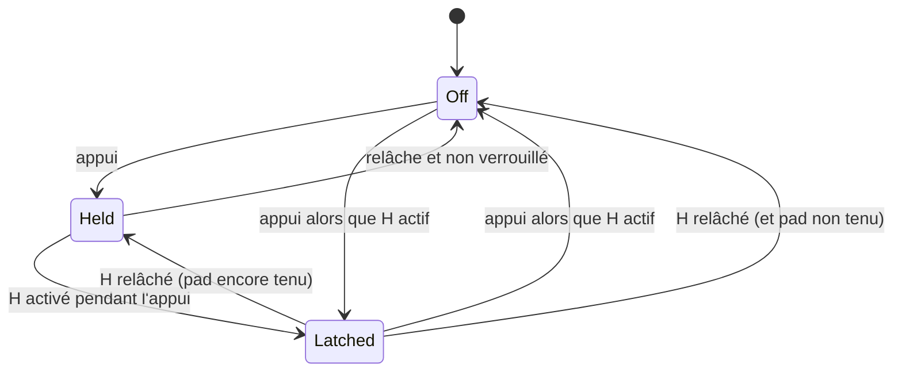

# feat: Frikfrak Glitch — effets de performance sur la piste Main

## Summary

Quatrième plugin et premier **effet audio** : posé sur la piste Main d'Ableton Live 12 Lite, il ajoute en live des effets « à pad » façon onglet Perform de Koala Sampler ou SP-404 MKII. Onze effets — Crush, Pitch, Reverb, Stutter, Gate, Phaser, Filter, Tape Stop, Reverse, Echo, Downer — chacun avec un pad maintenu (et verrouillable via Hold) et un ou deux potards. Stutter, Gate, Reverse, Tape Stop, Echo et Downer se calent sur le tempo de Live. Pilotage par pads à l'écran, MIDI Map de Live et notes MIDI. Pads relâchés : le son passe intact.

---

## Problem Frame

Les trois Frikfrak existants sont des instruments. Pour jouer un beat en live, il manque la couche « performance » d'un SP-404 ou de Koala : maintenir un pad pour faire bégayer, crusher, filtrer, arrêter la bande ou envoyer un écho, puis relâcher et retrouver le mix intact. Le plugin se place en fin de chaîne (piste Main), il ne doit donc rien colorer tant qu'aucun effet n'est actif, ni ajouter de latence.

---

## Requirements

- R1. Effet audio VST3/AU stéréo « Frikfrak Glitch », chargeable sur la piste Main (et toute piste audio) de Live 12 Lite.
- R2. Onze effets : Crush, Pitch, Reverb, Stutter, Gate, Phaser, Filter, Tape Stop, Reverse, Echo, Downer ; chacun 1 pad + 1 ou 2 potards (voir tableau du design).
- R3. Pads maintenus : l'effet joue tant que le pad est tenu. Pad **Hold** : verrouille les effets tenus au moment où il est activé ; Hold actif, un appui sur un pad bascule son verrou ; Hold relâché, tous les verrous tombent.
- R4. Trois sources de déclenchement équivalentes : pads cliquables à l'écran, paramètres hôte (automation, MIDI Map de Live), notes MIDI (VST3) — note tenue = pad tenu.
- R5. Effets rythmiques calés sur le tempo et la position de Live (Stutter, Gate, Reverse, Tape Stop, Echo, Downer), avec une horloge de secours à tempo constant quand le transport est arrêté.
- R6. Aucun pad actif et aucune traîne en cours : sortie identique bit à bit à l'entrée. Latence déclarée : 0.
- R7. Reverb et Echo en « throw » : au relâchement, la traîne continue de sonner (on coupe l'envoi, pas le retour).
- R8. Aucun clic à l'engagement ni au relâchement d'un effet, ni aux coutures de boucle (Stutter, Reverse).
- R9. Temps réel : pas d'allocation, de lock ni d'I/O dans `processBlock` ; sortie finie et bornée à tous les réglages.
- R10. Interface Frikfrak (palette, logo, potards) avec une rangée de pads lumineux qui reflètent l'état réel (souris, MIDI, automation, Hold).

---

## Key Technical Decisions

- **Effet audio avec entrée MIDI, pas instrument.** `IS_SYNTH FALSE`, `NEEDS_MIDI_INPUT TRUE`, `IS_MIDI_EFFECT FALSE`, `VST3_CATEGORIES Fx`. Un plugin coché « MIDI effect » ne se charge pas dans Live (forum JUCE). Côté AU, Live ne transmet pas le MIDI aux AU (Cableguys) : la version AU reste pilotable par pads et paramètres seulement ; le README le dit.
- **Pads = paramètres booléens + notes MIDI, état calculé dans le processeur.** Chaque pad est un `AudioParameterBool` (automatisable, assignable au MIDI Map). Dans le MIDI Map de Live, une note sur un interrupteur le *bascule*, tandis qu'un CC 127/0 le rend momentané (manuel Live 12) : le README conseille les pads du contrôleur en mode CC momentané, ou le routage de notes. L'état effectif d'un effet = tenu (paramètre ∨ note) ∨ verrouillé, calculé par une machine d'état pure C++ (`Pads`) testable.
- **Pads jamais restaurés** : à la relecture d'un set, pads et Hold repartent à 0 (un pad laissé actif via MIDI Map ne rouvre pas le set avec l'effet engagé). Les potards sont restaurés normalement.
- **Hold : interrupteur à l'écran, momentané en MIDI.** Avec une seule souris on ne peut pas tenir un pad et Hold à la fois : un clic sur Hold bascule le paramètre ; la note 47 et un CC momentané le tiennent tant qu'ils sont enfoncés. Hold actif, un clic sur un pad d'effet bascule son verrou ; Hold désactivé, tous les verrous tombent.
- **Notes MIDI fixes à partir de C1 (36)** : 36–46 = les 11 effets dans l'ordre des pads, 47 = Hold. C1 est la première note des pad controllers courants ; pas de « learn » (voir Deferred).
- **Onze effets, deux ajoutés aux neuf demandés** : Echo (Koala « Dub »/« Tempo Delay », SP-404 « DJFX Delay »/« Tape Echo ») et Downer (SP-404 : ralentissement cyclique, rate 1/32 → 2). Isolator écarté (doublon du filtre DJ) ; ring mod, vinyl sim, scatter en Deferred.
- **Chaîne série fixe, chaque effet autonome avec son propre tampon.** Ordre : Stutter → Reverse → Tape Stop → Downer → Pitch → Crush → Filter → Phaser → Gate → Echo → Reverb. Les effets de temps d'abord (Tape Stop après Stutter/Reverse pour « arrêter » tout), la Gate avant Echo/Reverb pour que les traînes survivent aux coupures. Les effets de temps, Pitch et Echo ont chacun leur tampon circulaire, alloué dans `prepare` et alimenté même inactifs (8 s : 2 mesures à 60 BPM). Les longueurs de division sont calculées avec un tempo plancher de 60 BPM (Live descend à 20), et Reverse borne son segment à la moitié du tampon puisqu'il relit jusqu'à 2 × sa longueur.
- **Engagement par fondu linéaire de 8 ms** (helper `Engage`) pour tous les effets, Echo et Reverb compris (le fondu porte sur leur envoi). Pour les effets corrélés au direct (Crush, Filter, Gate, Phaser), le linéaire évite la bosse d'un fondu à puissance constante ; pour les effets qui relisent le passé (temps, Pitch), le creux de −3 dB au milieu d'un fondu de 8 ms est inaudible. Bypass exact quand tous les fondus sont à 0 et que les traînes Echo/Reverb sont éteintes (mesurées sur leur état interne, voir U5).
- **Stutter « rétro-quantifié »** : à l'appui, la boucle démarre sur la dernière frontière de grille *passée* (déjà dans le tampon) — réponse immédiate et calée. Coutures de boucle en fondu 3 ms.
- **Tape Stop / Downer : tête de lecture à vitesse variable** dans le tampon, interpolation Hermite cubique 4 points. Tape Stop : vitesse 1 → 0 sur la durée choisie (courbe quadratique), puis tête « garée » et silence, quelle que soit la durée de maintien (Hold) ; au relâchement, le « tape start » repart de *maintenant − durée de la rampe* (toujours dans le tampon), vitesse 0 → 1 en 1/8 de temps, puis fondu vers le direct. Hermite : retard minimal de 2 échantillons (le point n+1 n'est pas encore écrit). Downer : la vitesse plonge à chaque période (rate) puis la tête se recale sur le direct en fondu.
- **Pitch : décalage par double tête rotative** (DAFX), fenêtre ~60 ms, fenêtres sin² sommant à 1. Pas de PSOLA (inadapté à un mix), pas de bibliothèque à latence (Signalsmith ~100 ms). Retard moyen ~30 ms quand l'effet est engagé : il fait partie de l'effet (comme un délai), pas de la compensation de latence. À 0 demi-ton, Pitch est un passe-plat exact (sinon les deux têtes figées forment un filtre en peigne).
- **Latence déclarée 0.** Une latence déclarée sur la Main retarderait toute la sortie même pads relâchés ; aucun effet ne fait de lookahead.
- **Horloge `BeatClock` pure C++** alimentée par `getPlayHead()->getPosition()` à chaque bloc (BPM, ppq, lecture) : ppq par échantillon ; ppq prédit avec le BPM du *nouveau* bloc ; saut (boucle, repositionnement) détecté au-delà d'1/4 de triple-croche d'écart (une automation de tempo ne déclenche donc rien) ; un saut recale la grille sans relancer les boucles en cours ; horloge libre au dernier BPM connu (120 sans aucun BPM reçu) quand le transport est arrêté ou la position absente.
- **Réutilisation du DSP partagé** : `dsp::Reverb` (FDN) en pur wet sur un envoi dont on coupe l'entrée ; `dsp::Phaser` reçoit une vitesse réglable (surcharge, 0,5 Hz par défaut : comportement du Rhodes inchangé). Les nouveaux effets restent dans `plugins/glitch/src/dsp/` (spécifiques à la performance).
- **Interface dédiée qui réutilise les briques communes.** L'éditeur générique ne connaît que des potards ; plutôt que de le surcharger, `ui::Knob` et le dessin d'en-tête sortent de `ui::Editor` pour être réutilisés par un `GlitchEditor` : une colonne par effet (nom, pad, potards), pad Hold à part. Les pads lisent l'état effectif via un masque atomique publié par le processeur (minuterie 30 Hz). Rhodes, Vinyl, Kankyo inchangés.
- **Pas de presets** : un effet de performance se règle au potard ; 27 paramètres (11 pads + Hold + 15 potards), sous la limite de 64 au-delà de laquelle Live demande « Configure ».
- **Nom et codes** : produit « Frikfrak Glitch », `PLUGIN_CODE Gltx`, dossier `plugins/glitch/`. À trancher avant le premier set sauvegardé : le code ne pourra plus changer.

---

## High-Level Technical Design

Chaîne du signal (stéréo, un bloc) :



Machine d'état d'un pad (H = pad Hold actif) :



Effet actif = `Held ∨ Latched`. « Appui » = front montant de (paramètre ∨ note MIDI), pour que souris, MIDI Map et notes se combinent sans se contredire.

Paramètres (ordre des colonnes de l'interface ; notes MIDI 36 → 46, Hold = 47) :

| # | Effet | Potards | Plages |
|---|---|---|---|
| 1 | Crush | Bits, Rate | 2–16 bits ; 1–24 kHz |
| 2 | Pitch | Semitones | −12 → +12, par demi-ton |
| 3 | Reverb | Size | réutilise `dsp::Reverb` (1,5 → 10 s) |
| 4 | Stutter | Division | 1/2, 1/4, 1/8, 1/16, 1/32, 1/8T, 1/16T |
| 5 | Gate | Rate, Depth | 1/4 → 1/32 (+ triolets) ; 0–100 % |
| 6 | Phaser | Speed | 0,1 → 4 Hz |
| 7 | Filter | Freq | −100 % passe-bas ← 0 neutre → passe-haut +100 % |
| 8 | Tape Stop | Time | 1/8, 1/4, 1/2, 1, 2 temps |
| 9 | Reverse | Length | 1/4, 1/2, 1 temps, 2 temps, 1 mesure |
| 10 | Echo | Time, Feedback | 1/8, 1/8D, 1/4, 1/4D, 1/2 ; 0–95 % |
| 11 | Downer | Rate, Depth | 1/32 → 2 temps ; 0–100 % |
| — | Hold | (pad) | verrou global |

Divisions = `AudioParameterChoice` (libellés affichés par le potard). Gammes Bits/Rate/Semitones/Gate/Tape Stop non documentées chez Roland ni Koala : choisies ici, à ajuster à l'écoute.

---

## Output Structure

```text
plugins/glitch/CMakeLists.txt
plugins/glitch/src/PluginProcessor.{h,cpp}     # glue JUCE : bus, params, playhead, MIDI, état
plugins/glitch/src/Params.h                    # ids, specs, divisions (C++ pur)
plugins/glitch/src/GlitchEditor.h              # colonnes effet + pads lumineux
plugins/glitch/src/dsp/BeatClock.h             # horloge tempo, horloge libre
plugins/glitch/src/dsp/Pads.h                  # machine d'état pads / Hold / notes
plugins/glitch/src/dsp/Engage.h                # fondu d'engagement, Hermite, tampon circulaire
plugins/glitch/src/dsp/TimeFx.h                # Stutter, Reverse, TapeStop, Downer
plugins/glitch/src/dsp/ColorFx.h               # Pitch, Crush, Filter, Gate
plugins/glitch/src/dsp/ThrowFx.h               # Echo, Reverb throw
plugins/glitch/src/dsp/Chain.h                 # ordre de la chaîne, bypass exact
```

---

## Implementation Units

### U1. Horloge, pads et briques communes (C++ pur)

**Goal:** `BeatClock`, `Pads` (machine d'état + notes 36–47), `Engage` (fondu 8 ms), tampon circulaire stéréo et lecture Hermite.
**Requirements:** R3, R4, R5, R8
**Dependencies:** aucune
**Files:** `plugins/glitch/src/dsp/BeatClock.h`, `plugins/glitch/src/dsp/Pads.h`, `plugins/glitch/src/dsp/Engage.h`, `tests/dsp_tests.cpp`, `CMakeLists.txt` (include path de `dsp_tests`)
**Approach:** `BeatClock::begin(bpm?, ppq?, playing, sr)` par bloc puis `ppqAt(i)` / frontières de division. Saut détecté si |ppq reçu − ppq prédit| > 1 échantillon. `Pads` reçoit par bloc l'état des paramètres et les événements note (position échantillon) et expose `active(i)` + un masque.
**Execution note:** test-first — c'est là que se logent les bugs silencieux (grille décalée, verrou qui reste collé).
**Patterns to follow:** `dsp::Smoother` (`shared/dsp/Effects.h`), structs `Params` de `plugins/vinyl-noise/src/dsp/Vinyl.h` et `plugins/kankyo/src/dsp/Pad.h` ; tests de `testEffects()`.
**Test scenarios:**
- BeatClock 120 BPM, 48 kHz, ppq 0 : frontière 1/16 suivante à 6000 échantillons ; plusieurs frontières dans un bloc de 4096 à 1/32 toutes trouvées.
- Transport arrêté, BPM reçu 140, ppq absent : l'horloge avance à 140 BPM ; aucun BPM jamais reçu : 120 BPM ; reprise de la lecture : recalage sur le ppq hôte ; boucle (ppq qui revient de 16 à 0) : saut détecté ; tempo qui passe de 120 à 121 BPM entre deux blocs : aucun saut détecté.
- Pads : appui/relâche sans Hold → actif puis inactif ; appui + Hold pendant l'appui → reste actif après relâche ; Hold actif, deux appuis → bascule on/off ; Hold relâché → tous inactifs sauf pads encore tenus ; Hold tenu par note 47 et basculé à l'écran → reste actif tant que l'un des deux l'est.
- Note 36 on/off → pad Crush actif/inactif ; note 47 = Hold ; notes hors plage ignorées ; paramètre et note tenus ensemble puis l'un relâché → reste actif.
- Engage : passe de 0 à 1 en 8 ms ± 1 échantillon, monotone ; à 0, la sortie est l'entrée bit à bit.
- Hermite à vitesse 1 et retard entier : sortie = échantillon stocké exact.

### U2. Squelette du plugin et routage MIDI dans Live

**Goal:** Effet chargeable, chaîne vide (passe-plat exact), paramètres, playhead → `BeatClock`, MIDI → `Pads`, état sauvegardé — et vérifier tôt que Live envoie le MIDI au plugin sur la Main.
**Requirements:** R1, R4, R6, R9
**Dependencies:** U1
**Files:** `plugins/glitch/CMakeLists.txt`, `plugins/glitch/src/PluginProcessor.{h,cpp}`, `plugins/glitch/src/Params.h`, `CMakeLists.txt`
**Approach:** Copie de `plugins/vinyl-noise/` adaptée : bus stéréo entrée + sortie, `IS_SYNTH FALSE`, `NEEDS_MIDI_INPUT TRUE`, `VST3_CATEGORIES Fx`, `PLUGIN_CODE Gltx`, `setLatencySamples(0)`. Paramètres créés depuis `Params.h` (bools, floats, choices). `getTailLengthSeconds` = traîne max Echo/Reverb. Masque actif publié en `std::atomic<uint32_t>` pour l'éditeur. État : potards sauvegardés, pads et Hold remis à 0 au chargement. `makeLayout` de `PresetHost` ne crée que des flottants : le layout de Glitch (bools, flottants, choix) est construit dans `Params.h`. Vérifier `isBusesLayoutSupported` (entrée stéréo = sortie stéréo ; Vinyl Noise n'a qu'une sortie). Éditeur générique provisoire.
**Execution note:** valider le routage avant d'investir dans les effets : piste MIDI → « MIDI To » → Main → Frikfrak Glitch, note 36 qui allume le pad Crush. Si Main n'est pas proposée en Live 12, le noter dans le README et s'appuyer sur MIDI Map CC (le plugin fonctionne quand même sur une piste audio de groupe).
**Patterns to follow:** `plugins/vinyl-noise/` (MIDI échantillon-précis dans `processBlock`), `plugins/kankyo/CMakeLists.txt`.
**Test scenarios:** Test expectation: none -- glue JUCE ; logique couverte par U1, intégration par `auval` et Live.
**Verification:** `auval -v aumf Gltx Frik` réussit ; le plugin apparaît dans Live sur la Main ; audio identique en entrée et en sortie (inversion de phase sur une piste de test = silence) ; le routage MIDI vers la Main est confirmé ou son absence documentée.

### U3. Effets de temps : Stutter, Reverse, Tape Stop, Downer

**Goal:** Les quatre effets qui relisent le passé, calés sur la grille.
**Requirements:** R2, R5, R8, R9
**Dependencies:** U1
**Files:** `plugins/glitch/src/dsp/TimeFx.h`, `tests/dsp_tests.cpp`
**Approach:** Voir KTD. Stutter : capture à la dernière frontière passée, longueur = division, boucle avec coutures 3 ms ; changement de division pendant l'appui pris à la frontière suivante. Reverse : lecture à rebours du dernier segment de la longueur choisie, segments successifs en fondu 8 ms. Tape Stop : courbe de vitesse quadratique sur la durée, silence ensuite, tape start au relâchement. Downer : vitesse qui plonge (profondeur) sur chaque période puis recalage en fondu.
**Execution note:** test-first sur les positions de boucle (calage de grille).
**Patterns to follow:** buffers alloués dans `prepare` comme `dsp::Chorus` (`shared/dsp/Space.h`).
**Test scenarios:**
- Stutter 1/16 à 120 BPM sur une rampe : la sortie se répète avec une période de 6000 échantillons ± 1, démarrée sur la dernière frontière passée ; pic d'écart aux coutures < 0,05 sur un sinus.
- Stutter appuyé hors lecture (horloge libre) : boucle toujours régulière.
- Reverse 1 temps sur une rampe montante : sortie descendante ; pas de saut > 0,05 aux limites de segment (sinus).
- Tape Stop 1 temps : hauteur d'un sinus 1 kHz qui décroît de façon monotone, sortie ≈ 0 après la durée ; relâche : retour au direct sans saut > 0,05.
- Tape Stop maintenu 20 s (plus que le tampon) puis relâché : aucun saut > 0,05, la sortie reprend l'audio récent (corrélation avec l'entrée des dernières 100 ms).
- Tempo hôte à 20 BPM : Reverse 1 mesure et Stutter 1/2 restent dans le tampon (longueurs calculées à 60 BPM), sortie finie et sans relecture d'audio écrasé.
- Downer profondeur 0 : sortie = entrée retardée de 0 (identique) ; profondeur 1 : fréquence mesurée sous la fréquence d'origine pendant la plongée.
- Les quatre, entrées bruit plein niveau et réglages extrêmes, 10 s : sortie finie, bornée ≤ 1,01.

### U4. Effets de couleur : Pitch, Crush, Filter, Gate, Phaser

**Goal:** Effets instantanés, plus la vitesse réglable du phaser partagé.
**Requirements:** R2, R8, R9
**Dependencies:** U1
**Files:** `plugins/glitch/src/dsp/ColorFx.h`, `shared/dsp/Effects.h`, `tests/dsp_tests.cpp`
**Approach:** Pitch par double tête rotative (60 ms, sin²). Crush : décimation par échantillonneur-bloqueur + quantification `round(x·q)/q`, bits lissés en flottant, pas de dither. Filter : SVF 2 pôles, bipolaire (négatif = passe-bas 20 kHz → 200 Hz, positif = passe-haut 20 Hz → 4 kHz), zone morte ±3 % au centre. Gate : gain lissé (attaque 2 ms, relâche 10 ms) sur la grille, profondeur = atténuation. `dsp::Phaser::process(l, r, amount, rateHz)` ajouté ; l'appel existant garde 0,5 Hz.
**Patterns to follow:** `dsp::Phaser`, `dsp::Tone` (`shared/dsp/Effects.h`) ; `goertzel` / `peakFreq` des tests.
**Test scenarios:**
- Pitch +12 sur sinus 440 Hz : pic mesuré à 880 Hz ± 2 % ; −12 → 220 Hz ; 0 demi-ton avec le pad engagé → sortie identique bit à bit à l'entrée.
- Crush 4 bits : au plus 16 niveaux distincts par polarité ; Rate 4 kHz : sortie constante par paliers de 12 échantillons à 48 kHz.
- Filter −100 % : sinus 5 kHz atténué > 20 dB, 100 Hz quasi intact ; +100 % : l'inverse ; Freq 0 : sortie = entrée.
- Gate 1/16, profondeur 100 % : énergie nulle sur les demi-pas fermés (à la tolérance des rampes), plus grand saut d'échantillon < 0,05.
- Phaser : l'appel existant donne une sortie bit à bit identique à avant (test Rhodes inchangé) ; vitesse 4 Hz → périodicité de modulation mesurable à 4 Hz ± 10 %.

### U5. Effets « throw » et chaîne complète : Echo, Reverb, bypass exact

**Goal:** Echo et Reverb dont la traîne continue après relâche ; assemblage de la chaîne dans l'ordre du design ; bypass bit à bit.
**Requirements:** R2, R6, R7, R8
**Dependencies:** U3, U4
**Files:** `plugins/glitch/src/dsp/ThrowFx.h`, `plugins/glitch/src/dsp/Chain.h`, `plugins/glitch/src/PluginProcessor.cpp`, `tests/dsp_tests.cpp`
**Approach:** Echo : ligne de délai stéréo calée sur la division, retour filtré (un peu sombre, façon bande), feedback ≤ 0,95 ; le pad ouvre l'envoi via `Engage` (8 ms), le retour reste toujours mixé. Reverb : `dsp::Reverb` en mix 1 sur l'envoi, retour ajouté au direct. Chaîne : chaque effet reçoit `Engage` + paramètres + horloge ; « au repos » = tous les fondus à 0 et traînes éteintes → aucun traitement de l'échantillon (les tampons des effets de temps et de Pitch continuent d'écrire). Traîne éteinte mesurée sur l'état interne, pas sur la sortie : Echo = crête de tout ce qui a été écrit dans sa ligne sur la dernière longueur de délai + un bloc < −90 dBFS ; Reverb = envoi fermé depuis au moins pré-délai + plus longue ligne, et sortie wet < −90 dBFS depuis. Sinon une tape brève passerait en bypass avant la première répétition et figerait la traîne.
**Patterns to follow:** `dsp::Reverb` (`shared/dsp/Space.h`).
**Test scenarios:**
- Aucun pad, 10 s de bruit : sortie identique bit à bit à l'entrée.
- Echo 1/4 à 120 BPM : impulsion répétée toutes les 24 000 échantillons ± 1, chaque répétition plus faible ; pad relâché après l'impulsion : les répétitions continuent ; un son envoyé après relâche n'est pas répété.
- Tape de 20 ms sur Echo 1/2 à 120 BPM : la première répétition sort bien 1 s plus tard (pas de bypass prématuré) ; même chose pour une tape de 20 ms sur Reverb.
- Reverb : pad 0,5 s sur du bruit puis relâché : énergie de traîne > 0 une seconde après, puis retour au bypass exact une fois sous −90 dBFS.
- Echo feedback 95 % sur 30 s : sortie finie et bornée, l'énergie décroît après coupure de l'envoi.
- Tous les pads actifs ensemble sur du bruit plein niveau : sortie finie, bornée ≤ 1,01.
- Engagement / relâche d'un pad au milieu d'un bloc : plus grand saut d'échantillon < 0,05 sur sinus.

### U6. Interface : colonnes d'effets et pads lumineux

**Goal:** `GlitchEditor` : une colonne par effet (nom, pad, potards), pad Hold, palette et en-tête Frikfrak ; potards de division affichant leur libellé.
**Requirements:** R10, R3, R4
**Dependencies:** U2
**Files:** `plugins/glitch/src/GlitchEditor.h`, `shared/ui/FrikfrakEditor.h`, `plugins/glitch/src/PluginProcessor.h`
**Approach:** Sortir `Knob` et le dessin de l'en-tête de `ui::Editor` en éléments de `namespace ui` réutilisables (rendu des trois plugins existants inchangé). `Knob` affiche le texte du paramètre pour les `AudioParameterChoice` (« 1/16T »). Pad d'effet : appui souris = paramètre à 1 (avec geste hôte), relâche = 0 ; Hold actif, un clic bascule le verrou. Pad Hold : un clic bascule. Pads allumés (accent) selon le masque atomique du processeur, lu par minuterie 30 Hz — un pad verrouillé ou tenu en MIDI s'allume aussi. Disposition : 2 rangées de 6 colonnes (11 effets + Hold), chaque colonne = nom, pad, 1–2 petits potards ; ~800 px de large.
**Patterns to follow:** `shared/ui/FrikfrakEditor.h` (LookAndFeel, palette, `Knob`).
**Test scenarios:** Test expectation: none -- UI ; vérification par rendu PNG (harnais hors dépôt, comme pour Kankyo) et en jeu dans Live.
**Verification:** pads cliquables et lumineux, y compris déclenchés par note MIDI ou verrouillés ; Rhodes, Vinyl, Kankyo identiques à leurs rendus précédents.

### U7. Documentation

**Goal:** README (plugin, effets et potards, notes MIDI 36–47, Hold, mise en place dans Live : piste Main, routage « MIDI To », MIDI Map avec pads en CC momentané, limite AU sans MIDI, `auval -v aumf Gltx Frik`) et `CLAUDE.md` (premier effet audio, `plugins/glitch/src/dsp/`, `ui::Knob` partagé).
**Requirements:** R1, R4
**Dependencies:** U5, U6
**Files:** `README.md`, `CLAUDE.md`
**Test scenarios:** Test expectation: none -- documentation.

---

## Scope Boundaries

- Pas de séquenceur ni d'enregistrement de mouvements de pads ; pas de presets.
- Pas de pad XY ni de scènes (Koala) ; pas de contrôle au clavier d'ordinateur (Live garde le focus clavier).
- Un seul exemplaire de chaque effet, ordre de chaîne fixe.

### Deferred to Follow-Up Work

- Ring mod, Vinyl sim (wow/flutter, bruit), Scatter (glitch aléatoire), Isolator 3 bandes.
- MIDI learn des notes ; vélocité → intensité.
- Pitch de meilleure qualité (bibliothèque à latence) si la double tête sonne trop « granuleuse » sur le mix.

---

## Risks & Dependencies

| Risque | Mitigation |
|---|---|
| Live 12 ne propose plus « MIDI To → Main » (sources de 2008, non documenté officiellement) | Vérifié dès U2 ; repli documenté : MIDI Map en CC momentané, ou plugin sur une piste de groupe |
| AU sans MIDI dans Live | VST3 recommandé dans le README ; AU pilotable par pads/paramètres |
| Comportement du playhead de Live transport arrêté (ppq figé ou absent) non vérifié | `BeatClock` retombe sur l'horloge libre ; journaliser les valeurs reçues pendant U2 |
| Pitch double tête « granuleux » sur basses | Fenêtre 60 ms, à ajuster à l'écoute ; alternative en Deferred |
| Clics aux coutures (Stutter, Reverse, Tape Stop) | Fondus 3–8 ms + tests de saut maximal |
| Mémoire : tampons de 8 s stéréo (4 effets de temps) + Pitch + Echo | ~25 Mo à 96 kHz, ~50 Mo à 192 kHz, alloués une fois dans `prepareToPlay` |
| Modifier `shared/` (Phaser, Editor) casse les autres plugins | Surcharges rétrocompatibles, test Rhodes bit à bit, rendus des trois éditeurs |

---

## Sources & Research

- Koala FX (même moteur que Koala Sampler) : Crush, Pitch, Ring, Reverb, Stutter, Gate, Filter LP/HP, Cutter, Reverse, Dub, Tempo Delay… ; effets « one touch », mode Hold global — [Synth Anatomy](https://synthanatomy.com/2020/08/koala-fx-is-a-new-creative-touch-multi-fx-processor-for-ios.html). Liste exacte de l'onglet Perform de Koala Sampler : non vérifiée.
- SP-404 MKII : Stopper, Back Spin (1/1 → 1/16), DJFX Delay, Super Filter, Ha-Dou… — [Roland](https://articles.roland.com/watch-10-creative-sp-404mkii-performance-effects-in-action/) ; Downer (rate 1/32 → 2), DJFX Looper, Scatter, Isolator — [manuel de référence v3](https://static.roland.com/manuals/sp-404mk2_reference_v300/eng/62589099.html).
- MIDI Map Live 12 (note = bascule, CC = momentané ; > 64 paramètres → Configure) — [manuel Live 12](https://www.ableton.com/en/live-manual/12/midi-and-key-remote-control/), [Using Plug-ins](https://www.ableton.com/en/live-manual/12/using-plug-ins/).
- Routage MIDI vers un effet — [Cableguys](https://www.cableguys.com/midi-trigger-in-ableton-live) (AU sans MIDI dans Live), [forum Ableton, master](https://forum.ableton.com/viewtopic.php?t=102760) (2008) ; « MIDI effect » ne se charge pas — [forum JUCE](https://forum.juce.com/t/vst3-midi-plugins-wont-load-in-ableton-live/36323/24).
- `AudioPlayHead::PositionInfo` — [docs JUCE](https://docs.juce.com/master/classAudioPlayHead.html).
- Pitch par lignes à retard (Zölzer, *DAFX*) et interpolation Hermite (Niemitalo) : références classiques, citées de mémoire.
